# Doctor Tracker

## Description

**Doctor Tracker is a secure admin console for clinics and hospital networks to manage their doctors and the patients under each doctor's care.** Administrators sign in to a protected portal where they can register doctors, assign, edit, reassign and remove patients, and find any record instantly with search, rich filters and pagination. A live analytics dashboard shows the network's health: totals, admissions over time, patients per doctor, the condition mix and where demand is concentrated by specialization. It is built to stay fast and consistent from a few hundred records to millions, with index-backed queries, Redis caching that degrades gracefully, and transactional writes.

| | |
|---|---|
| **Frontend** | Next.js 16 (App Router) · React 19 · TypeScript · Tailwind CSS v4 · TanStack Query · nuqs · Recharts · Radix UI |
| **Backend** | Node.js · Express 5 · TypeScript · Mongoose 9 · Zod 4 · Pino |
| **Data** | MongoDB 8 (replica set, transactions) · Redis 7 (cache, rate limits, idempotency) |

**Demo credentials** (created by `pnpm seed`): `admin@doctortracker.dev` / `ChangeMe!2026`

---

## Setup Guide

**Prerequisites:** Node.js ≥ 20.19, pnpm ≥ 10, Docker.

```bash
# 1. Install dependencies (pnpm workspace: apps/api, apps/web, packages/contracts)
pnpm install

# 2. Start MongoDB (single-node replica set) and Redis
#    Host ports default to 27027 / 6389 so they don't clash with other local services;
#    override with MONGODB_HOST_PORT / REDIS_HOST_PORT.
pnpm services:up

# 3. Configure environment
cp apps/api/.env.example apps/api/.env          # then set the two token secrets:
openssl rand -base64 48                          # → ACCESS_TOKEN_SECRET
openssl rand -base64 48                          # → REFRESH_TOKEN_SECRET
cp apps/web/.env.example apps/web/.env.local

# 4. Create indexes, the admin account and demo data (60 doctors, 2,400 patients)
pnpm seed

# 5. Run API (http://localhost:4100) and web app (http://localhost:3100)
pnpm dev
```

Open **http://localhost:3100** and sign in with the demo credentials.

| Command | Purpose |
|---|---|
| `pnpm dev` | API + web in watch mode |
| `pnpm build` | Production builds of both apps |
| `pnpm typecheck` / `pnpm lint` / `pnpm test` | Quality gates for all packages |
| `pnpm seed` | Sync indexes, upsert the admin, add demo data if empty |
| `pnpm --filter @doctor-tracker/web screenshots` | Regenerate the screenshots below (app must be running) |

Environment files: [`apps/api/.env.example`](apps/api/.env.example) · [`apps/web/.env.example`](apps/web/.env.example). The API validates its environment at startup and refuses to boot with a clear list of problems.

---

## System Architecture

```
┌──────────────┐  same-origin   ┌─────────────────────┐   REST /api/v1    ┌──────────────────────────┐
│   Browser    │ ─────────────► │  Next.js (apps/web) │ ────────────────► │  Express API (apps/api)  │
│  React UI    │  /api/* + UI   │  · App Router UI    │  rewrite (proxy)  │  routes → controllers →  │
│  TanStack Q. │ ◄───────────── │  · proxy.ts guard   │ ◄──────────────── │  services → repositories │
└──────────────┘  httpOnly      └─────────────────────┘                   └────────┬────────┬────────┘
                  cookies
                                                                                   │        │
                                                     transactions, indexed queries │        │ cache-aside, rate
                                                                                   ▼        ▼ limits, idempotency
                                                                         ┌────────────┐ ┌─────────┐
                                                                         │ MongoDB rs0│ │  Redis  │ (optional:
                                                                         └────────────┘ └─────────┘  fail-open)
                         packages/contracts — Zod schemas, types, enums shared by web and API
```

**Request flow.** The browser only ever talks to the Next.js origin. `/api/*` is rewritten to the standalone Express API, so session cookies are first-party, `SameSite=strict` and invisible to JavaScript. `proxy.ts` (Next 16's middleware) redirects visitors without a session cookie to `/login`. That is a UX gate only: the API verifies every request itself.

**API layering (SOLID).** Each module (`auth`, `doctors`, `patients`, `analytics`) is `routes → controller → service → repository → model`. Controllers only parse input (Zod) and shape HTTP. Services hold the business rules and depend on *interfaces* (`DoctorRepository`, `KeyValueStore`, `TransactionRunner`, `PasswordHasher`). Concrete Mongo/Redis/argon2 implementations are wired in one composition root, [`container.ts`](apps/api/src/container.ts).

**Shared contracts.** [`packages/contracts`](packages/contracts/src) defines every request schema, enum and response type once. The API validates with the same Zod schemas the web forms use, so client and server validation can never drift.

**Data model and indexes.** Every list query shape has a matching compound index ending in `_id`. The `_id` tiebreaker makes sorting stable, and with it in the index MongoDB answers "filter + sort + page" by reading only one page of index entries, with no in-memory sort. This was verified with `explain()`: `docsExamined = pageSize`.

| Collection | Notable fields | Indexes |
|---|---|---|
| `doctors` | `patientCount` (denormalized), `searchKeywords`, `normalizedName` | `email` unique · `{createdAt,_id}` · `{specialization,createdAt,_id}` · `{hospital,createdAt,_id}` · `{normalizedName,_id}` · `{patientCount,_id}` · `{searchKeywords}` |
| `patients` | `doctor` ref, `condition`, `admittedAt`, `version` | `{admittedAt,_id}` · `{doctor,admittedAt,_id}` · `{condition,admittedAt,_id}` · `{gender,admittedAt,_id}` · `{normalizedName,_id}` · `{createdAt,_id}` · `{searchKeywords}` |
| `users` / `refresh_sessions` | lockout counters / HMAC'd refresh tokens | `email` unique / `tokenHash` unique, `familyId`, TTL on `expiresAt` |

**Scale, resilience and consistency at a glance**

- **Search** uses an anchored prefix regex on a normalized multikey `searchKeywords` field, so it runs as an index range scan (not a collection scan) and still matches first names, last names, email and phone.
- **Counts:** unfiltered totals use `estimatedDocumentCount()` (O(1)). Per-condition and per-window counts are index `COUNT_SCAN`s. "Patients per doctor" reads the denormalized `patientCount`.
- **Caching:** a Redis cache-aside layer has versioned namespaces (invalidation is one `INCR`) and in-process request coalescing (stampede protection). It is **fail-open**: if Redis is down, the API serves straight from MongoDB and `/health/ready` reports `cache: degraded`.
- **Consistency:** patient create/delete/reassign update `patientCount` in the **same MongoDB transaction**. Patient edits use **optimistic concurrency** (`version`), so a stale save returns `409 STALE_VERSION` instead of silently overwriting someone else's change. Create endpoints accept an `Idempotency-Key`, so retries and double-clicks never create duplicates.
- **Security:**
  - passwords are hashed with Argon2id (OWASP parameters), with a timing-equalized response for unknown emails;
  - accounts lock after 5 failed sign-ins;
  - access JWTs live 15 minutes, and refresh tokens are opaque, rotate on every use, are stored as HMACs, and replaying an old one revokes the whole session family;
  - rate limits are shared through Redis;
  - Helmet and a strict CSP are in place, and mutations from foreign `Origin`s are rejected;
  - Zod strips unknown keys (no operator injection), regex input is escaped, JSON bodies are capped at 100 KB, and logs redact secrets;
  - only same-site `?next=` redirects are honoured after sign-in.
- **Horizontal scaling:** the API is stateless (JWT verification needs no DB hit), with Redis-backed limits and graceful shutdown. `/api/v1/health/live` and `/health/ready` serve as probes.

---

## Technical Decisions

### 1. TanStack Query + URL state instead of Redux (or Context)

Almost all state in this app is **server state**: lists, details and analytics owned by the API. Redux would mean hand-writing loading flags, cache invalidation, deduplication and refetch logic for every resource. Context would re-render whole subtrees on every change. TanStack Query is purpose-built for exactly this:

- **Caching and deduplication** with hierarchical keys (`['patients', 'list', query]`): invalidating `['patients']` refreshes every page and filter combination after a write.
- **No-jank pagination:** `keepPreviousData` keeps the current page visible (dimmed) while the next loads, and the following page is **prefetched**, so "Next" is usually instant.
- **Optimistic deletes** with automatic rollback if the server rejects the change.
- **Resilience:** retries only transient failures (network/5xx) with exponential backoff, never 4xx.

The remaining *client* state (filters, search, sort, page, dashboard range) lives in the **URL** via `nuqs`, not in a store. Views are shareable and bookmarkable, survive reloads and work with the back button, and changing a filter resets to page 1. Local UI state (dialogs, form drafts) stays in components. The result has no global store, minimal re-renders, and one clear owner for each kind of state.

### 2. A standalone Express API behind a same-origin Next.js rewrite, with cookie sessions

The spec requires a separate Express server. Calling it cross-origin from the browser would force a choice: tokens in `localStorage` (readable by any XSS), or cross-site cookies (`SameSite=None` plus CORS credentials, which widens the CSRF surface). Instead, Next.js rewrites `/api/*` to the API:

- Sessions are **httpOnly, `SameSite=strict` cookies on the app's own origin**. JavaScript can never read a token, and no CORS configuration is involved in the browser path.
- The refresh cookie is scoped to `/api/v1/auth`, so it is never sent with data requests. A secret-free, `Lax` "session hint" cookie lets the route guard work after the 15-minute access token expires, and when a link to the app is opened from another site.
- The browser's HTTP client performs **single-flight token refresh**: when ten requests hit 401 at once, one refresh call is made and all ten retry.
- The API remains a normal, independently deployable REST service (it also accepts `Authorization: Bearer` for non-browser clients) and stays stateless, so it scales horizontally behind any load balancer.

*Also worth noting:* **index-friendly prefix search instead of `$regex` contains / `$text`.** An unanchored case-insensitive regex forces a collection scan, which is unusable at millions of rows. `$text` cannot match partial words. Storing normalized word keywords and matching `^term` against a multikey index gives type-ahead search that stays fast at any scale.

---

## Visual Evidence

Screenshots are generated by [`apps/web/scripts/capture-screenshots.mjs`](apps/web/scripts/capture-screenshots.mjs) (Playwright, 2×/3× pixel density).

### Desktop (1440 × 900)

| Dashboard | Doctors |
|---|---|
| 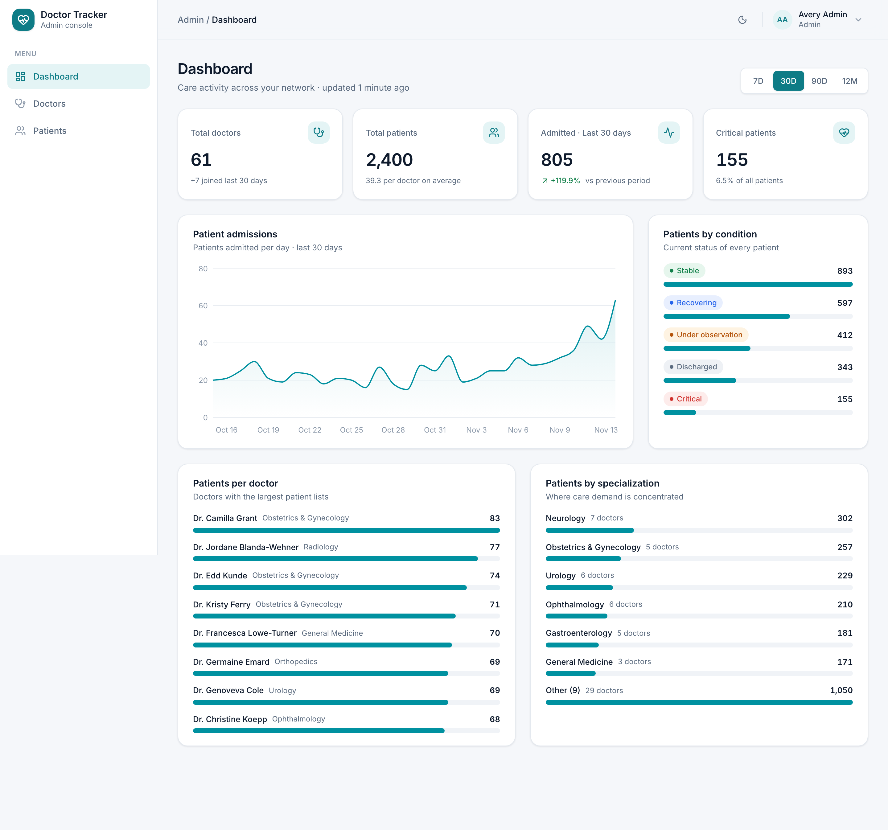 | 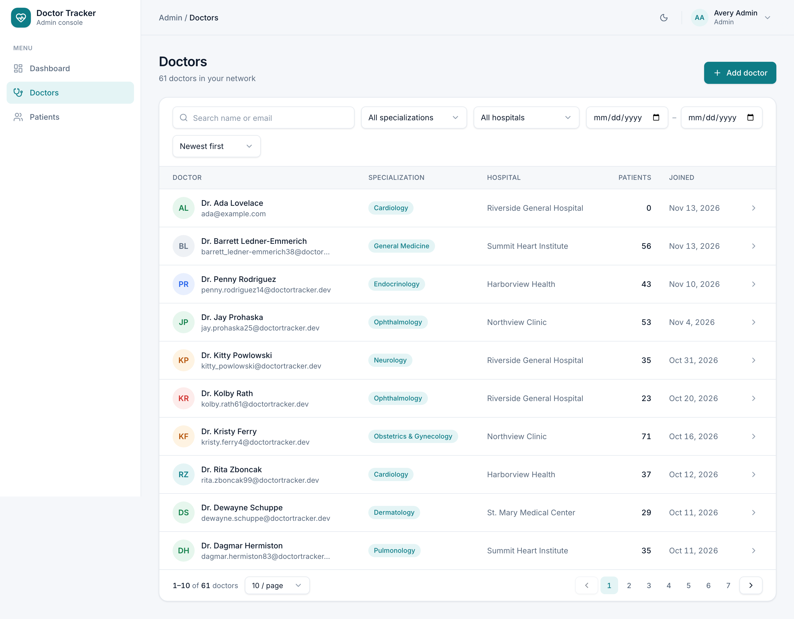 |
| **Doctor detail & patients** | **Patients** |
| 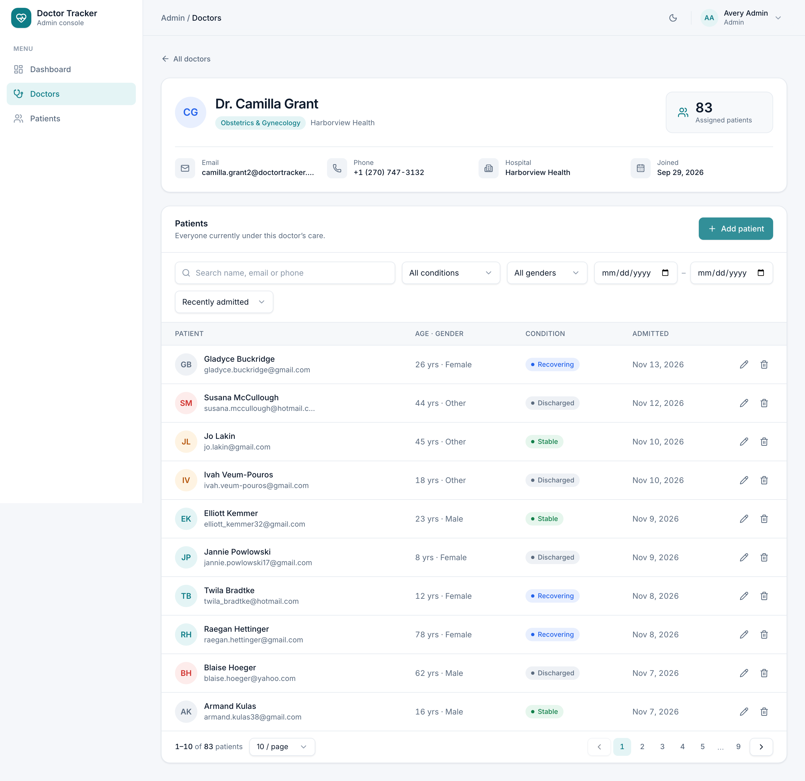 | 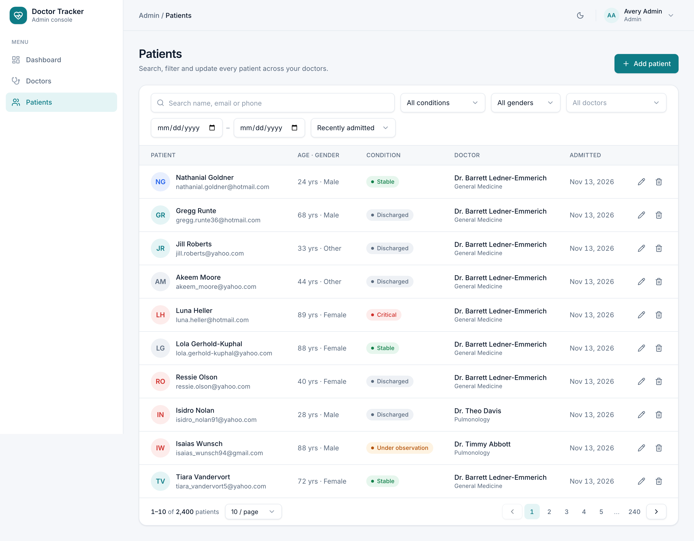 |
| **Add doctor** | **Edit patient** |
| 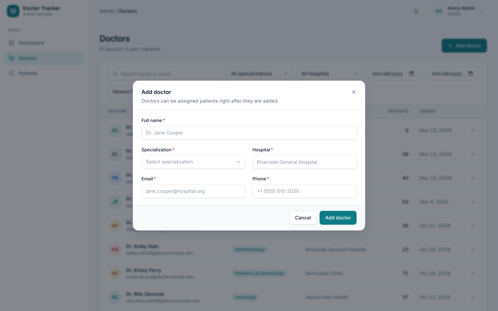 | 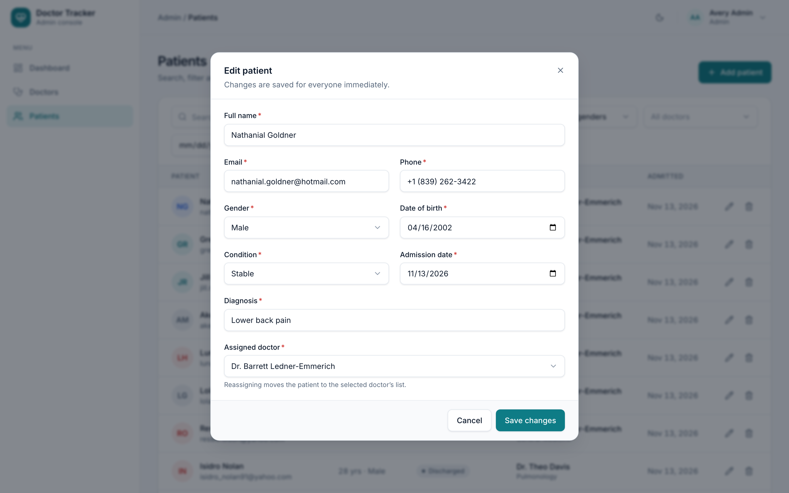 |
| **Sign in** | **Dark mode** |
| 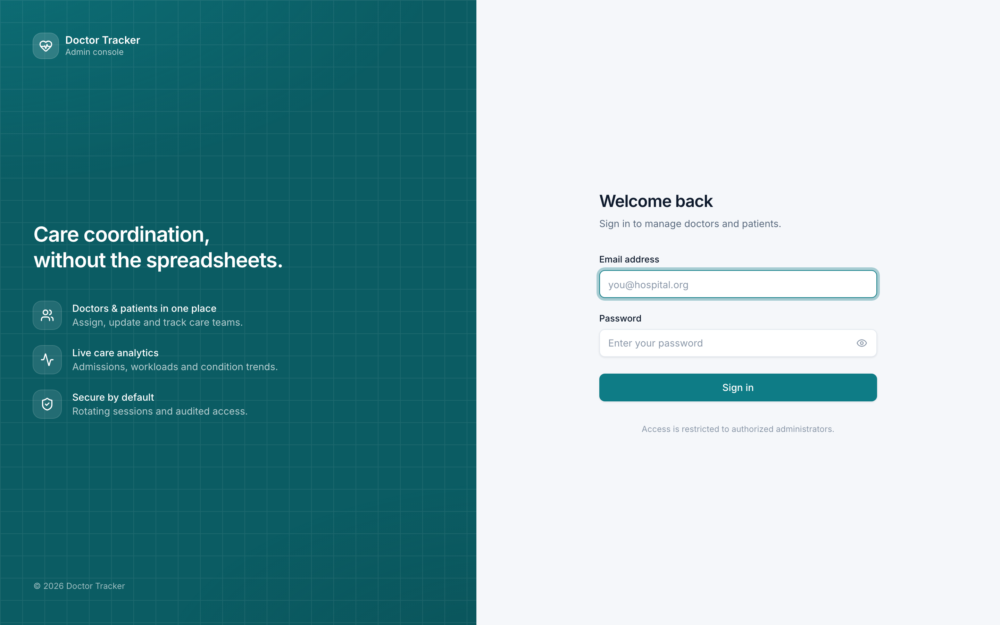 | 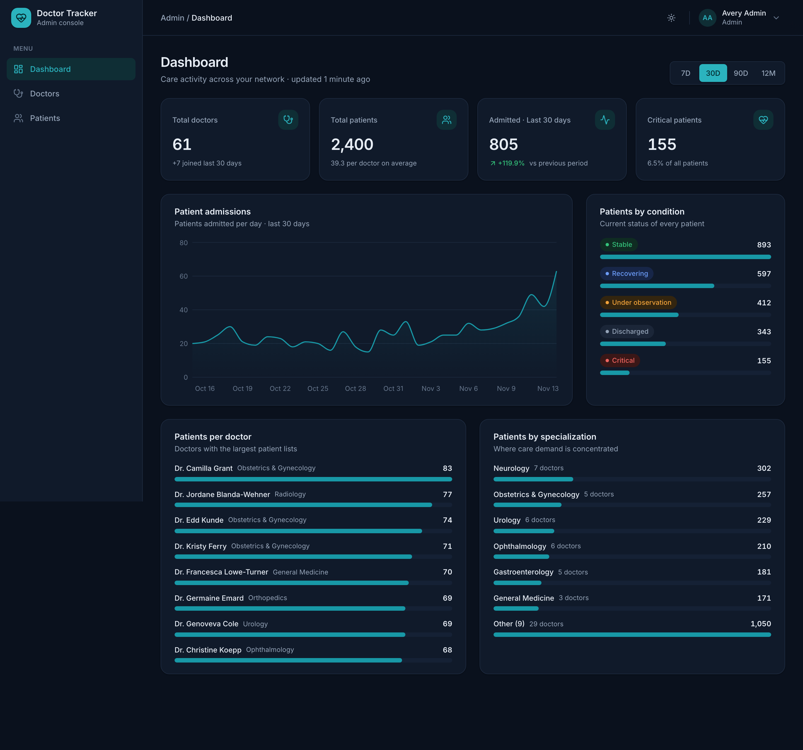 |

### Mobile (390 × 844)

| Sign in | Dashboard | Doctors | Doctor detail | Patients | Edit patient |
|---|---|---|---|---|---|
| 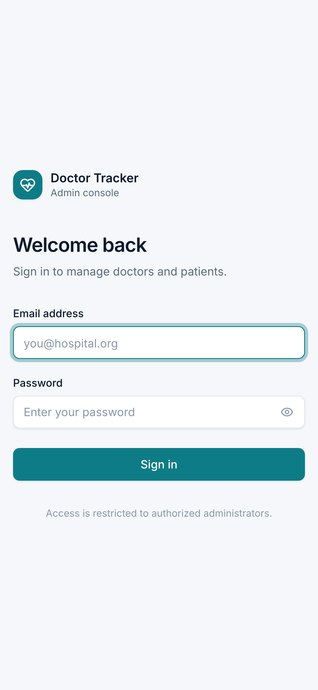 | 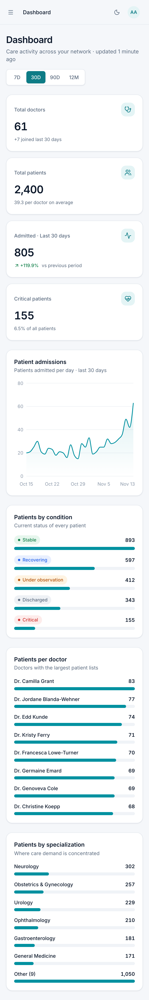 | 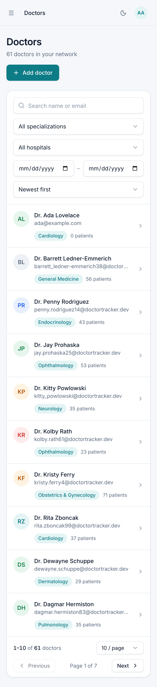 | 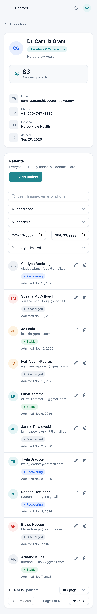 | 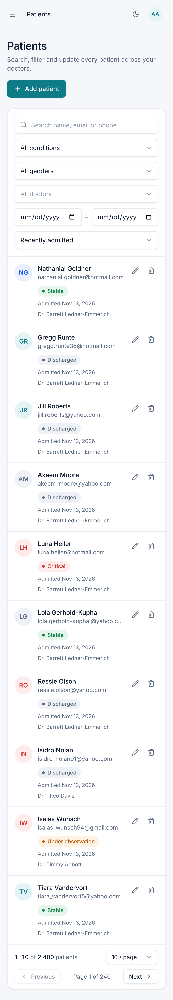 | 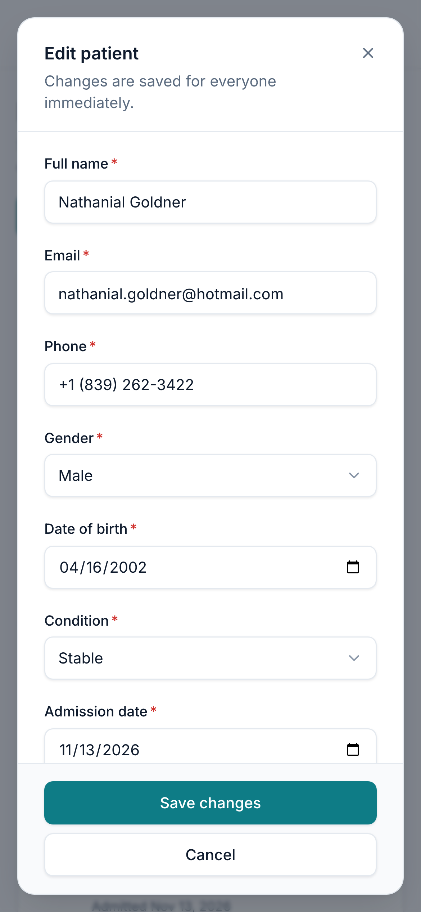 |

More, including dark-mode versions of every screen, are in [`docs/screenshots`](docs/screenshots). The project plan and task breakdown are in [`docs/PROJECT_PLAN.md`](docs/PROJECT_PLAN.md).
